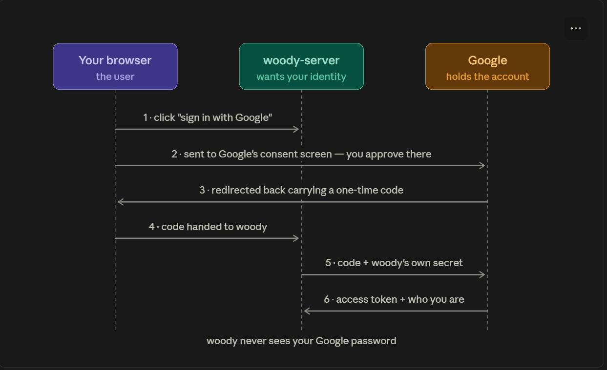

- Authentication methods all answer the same question :- "who is making this request". They differ in what evidence they accept and who holds.

  
- To ensure secure communication, it's essential to authenticate the parties involved in the API transactions.
- The authentication process confirms the identity of the API user.
- Each authentication method has its own pros and cons

- There are different types of authentication methods:- 
    1- Basic authentication
        - Or Basic auth, is a simple method often used in API design for handling user authentication.
        - Client credentials, consisting a username and password pair, are passed to the API server in a field in the HTTP header.
        - The server then verifies these credentials before granting access to protected resources.
        - Basic auth is straightforward to implement, it is less secure compared to more advanced methods since it involves transimitting credentials in an encoded, but not encrypted, format. ( why encoded not encrypted ? )

    2- JSON Web Token ( JWT )
        - JWTs are a popular and secure method of transferring information between two parties in the domain of API design.
        - As a compact, URL-safe means of representing claims to be transferred between two parties, they play a vital role in security and authorization in modern APIs.
        - By encoding these claims, the information can be verified and trusted with a digital signature - ensuring that the API end-points can handle requests in a secure and reliable way.
        - JWT is a relatively lightweight and scalable method that brings improved authentication and information exchange process in API design.

        => Problems that JWTs solve:-
            - "HTTP forgets who you are between request". The signed token re-introduce the user on every request, so stateless HTTP gets presistent identity without the protocol changing at all.
            - "The server must store every active login". No sessions table, no Redis, no memory per user - the client carries its own proof. Millions of logged-in users cost the server zero storage.
            - "Every request costs a database lookup just to know who's calling". Verification is a signature calculation in memory instead of a round trip to a session store.
            - "Logins break when you run more than one server". With a guest-list approach, server B doesn't know about a session created on server A - you need shared storage or "sticky" load balancing. With JWTs, any server holding the key can verify any token; scaling horizontally requires nothing extra.
            - "Credentials shouldn't be sent repeatedly". Without tokens, proving identity per-request means Basic-Auth-Style password-on-every-call. The JWT lets password be transmitted once at login, then replaced by a time-limited stand-in.
    
        => Steps to implement JWTs:-
            a- Install required libraries for generating a jwt token and verify it.
            b- Create the signing secret. Generate a long random value, put it in .env ( secret key )
            c- Issue the token at login. Verify credentials, then sign a small payload.
            d- Store it on the client. localStorage or memory + refresh token. 
            e- Attach it to every request. Manually per call, or once via interceptor.
            f- Verify in a middleware. Extract, verify.
            g- Protect the routes. Identity first, permissions after.
            h- Handle the token's death on the client. Any 401 means the ticket is gone.
            i- Prove it works ( the test matrix )

    3- Token Based Auth
        - Token-based authentication is a crucial aspect of API design.
        - It involves providing the user with a token that validates their identity after they have successfully logged in.
        - Once the token is obained, users can use it to access resources and services provided by the API.
        - This token is usually passed in the headers of subsequent HTTP requests done by the client. 
        - One key advantage of token-based auth is that tokens can be created and checked by the server without storing them persistently, which can help to scale applications more easily. 
        - This authentication method enhances the security and scalability of web applications and it is mainly used in modern API strategies, including RESTful APIs.

        => How to implement it:-
            a- Create the ledger. The table is the auth system:
                CREATE TABLE tokens (
                    token_hash TEXT PRIMARY KEY,
                    user_id INT NOT NULL REFERENCES users(id) ON DELETE CASCADE,
                    expires_at TIMESTAMPTZ NOT NULL,
                    created-at TIMESTAMPTZ NOT NULL DEFAULT now(),
                    last_used_at TIMESTAMPTZ
                );

                - Note it's token_hash, not token
            
            b- Generate the token at login, after verifying the password.
                - const token = crypto.randomBytes(32).toString("hex");
                - That is the whole generation - no claims, no signing, no structure. 
                - Its only quality is being unguessable: 32 random bytes means an attacker brute-forcing ids will die of old age first.
                - Never generate tokens from Math.random() or timestamps - crypto.randomBytes or nothing

            c- Store its hash, hand out the original
                - const tokenHash = crypto.createHash("sha256").update(token).digest("hex");
                  
                  await pool.query(
                    `insert into tokens (token_hash, user_id, expires_at)
                    values ($1, $2, now() + interval '30 days')`,
                    [tokenHash, user.id],
                  )

                  res.json({ user: { id: user.id, name: user.name }, token }); //Plain token leaves once

                - Why hash it? => if your database ever leaks, a tokens table of plain tokens is a bag of working master keys; a table of hashes is uselss to the thief
            
            d- Client side: unchanged. Store it, send Authorization: Bearer <token>.
                - One of opaque tokens' quiet virtues: the client can't tell the species apart, so switching later breaks nothing.

            e- The middleware: a lookup instead of a verify.
                - async function requireAuth(req, res, next) {
                    const token = req.headers.authorization?.replace("Bearer ", "");
                    if (!token) return res.status(401).json({ message: "Not authenticated" });

                    const tokenHash = crypto.createHash("sha256").update(token).digest("hex");
                    const result = await pool.query(
                        `select u.id, u.name, u.role
                        from tokens t join users u on u.id = t.user_id
                        where t.token_hash = $1 and t.expires_at > now()`,
                        [tokenHash]
                    );
                    
                    if (!result.rows[0]) return res.status(401).json({ message: "Invalid or expired token })

                    req.user = result.rows[0];
                    next();
                }

                - Hash the incoming token, look it up, check expiry in the same query.

            f- Revocation: the payoff step. the one JWT can't do:
                - // logout this device 
                await pool.query("delete from tokens where token_hash = $1", [tokenHash]);

                - // logout everywhere / disable a compromised account
                await pool.query("delete from tokens where user_id = $1", [userId])

            g- Ledger hygiene.
                - Expired rows don't delete themselves: sweep them on a schedule so the table doesn't grow forever.
                - DELETE FROM tokens WHERE expires_at < now();

            h- Test the matrix.

